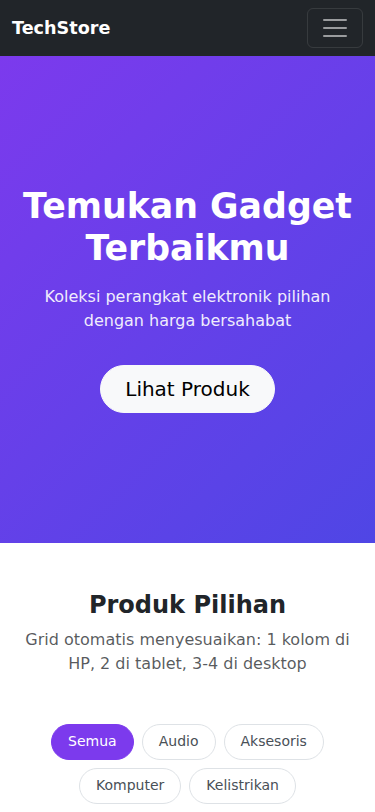
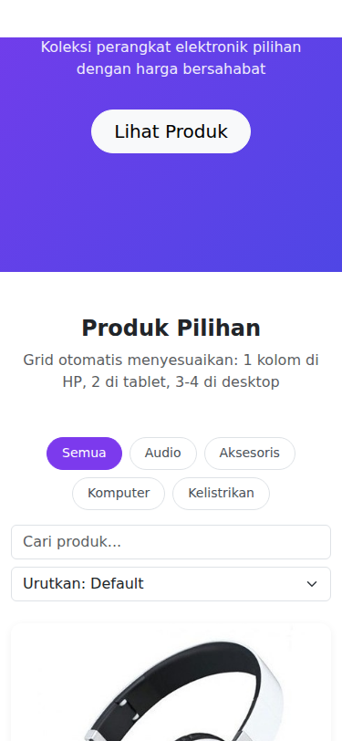
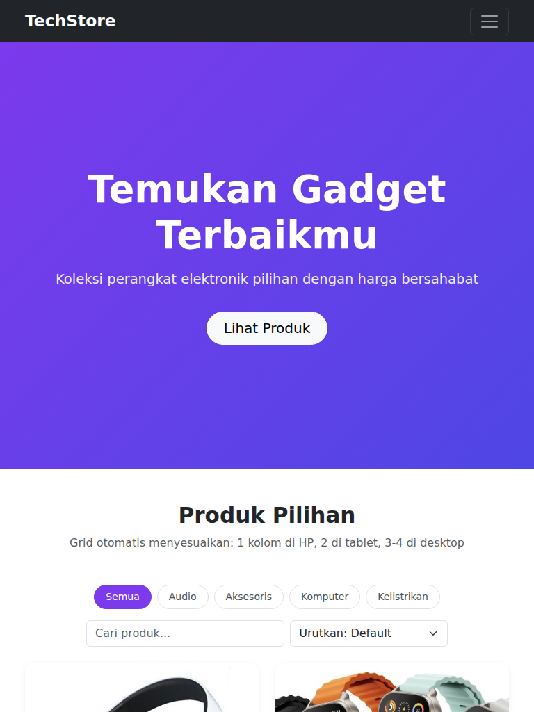
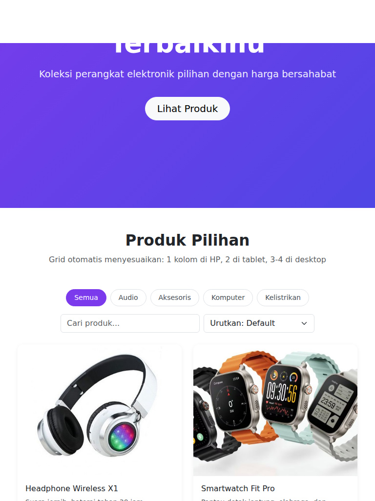
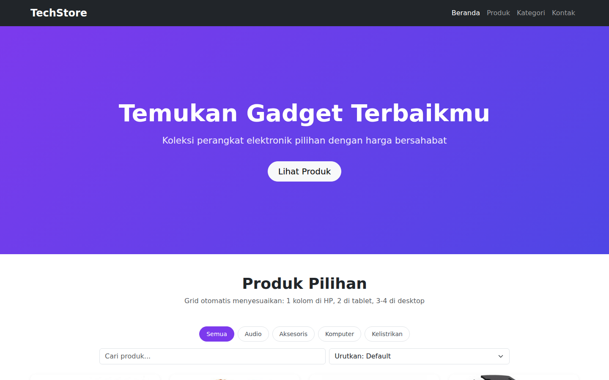
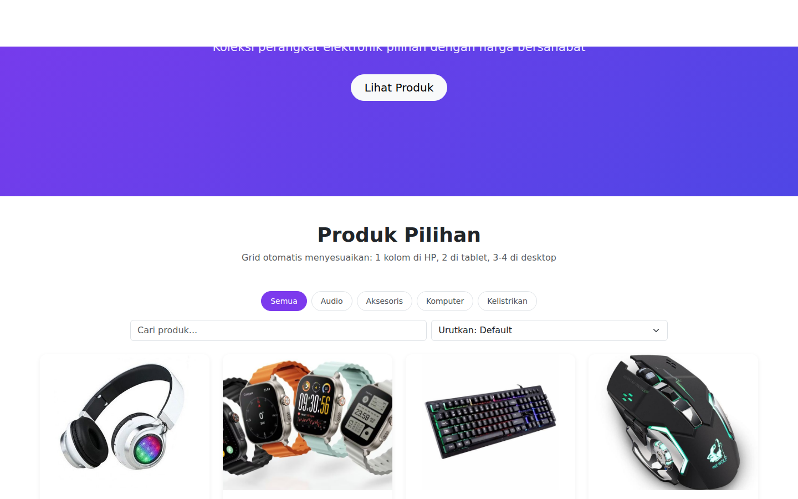
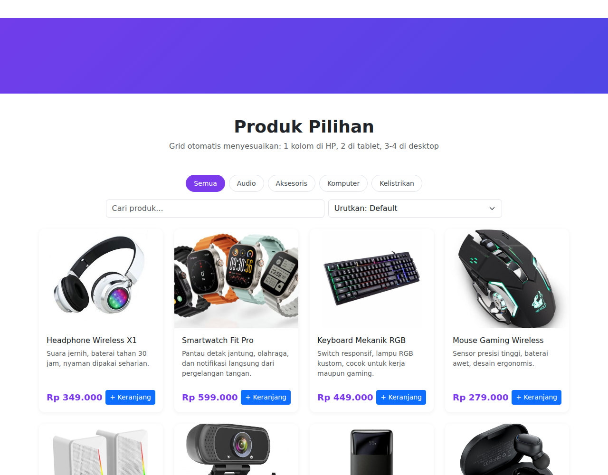
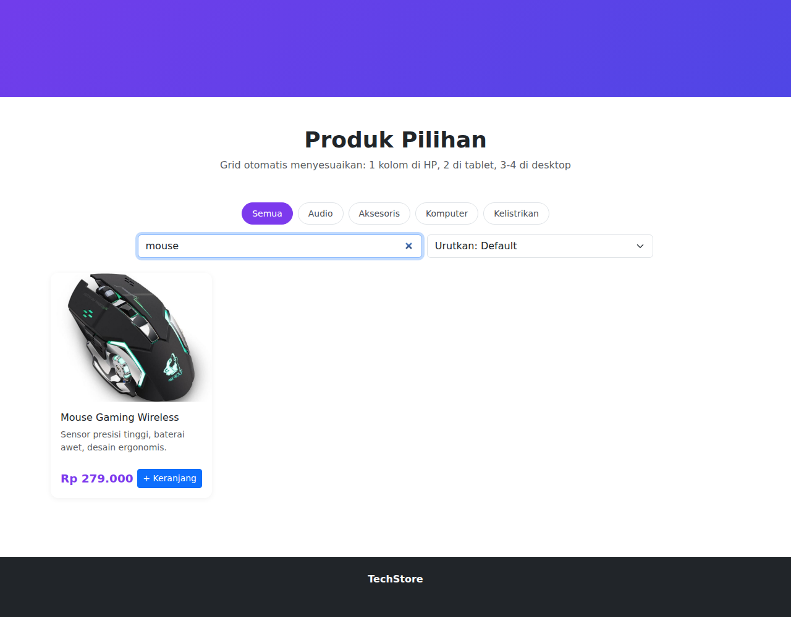
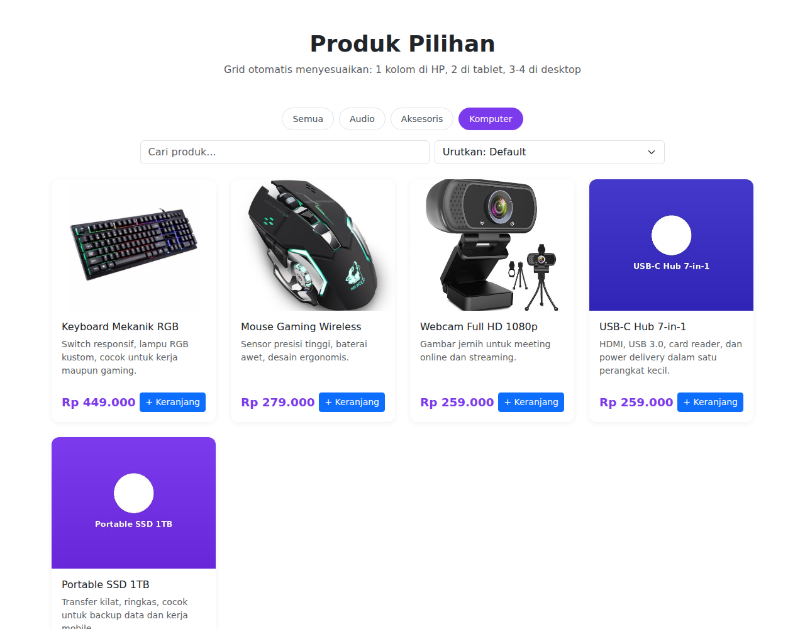
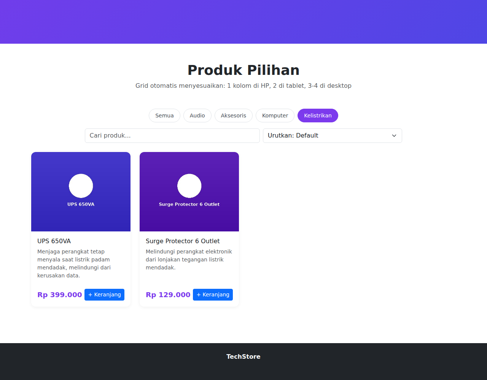

# Dokumentasi Testing — Katalog Produk Responsif (Bootstrap 5)

Halaman diuji pada 3 breakpoint utama untuk memverifikasi perubahan tata letak grid, navbar, dan typography.

## 1. Mobile — 375px (contoh: iPhone SE/12/13 mini)
Layout: navbar berubah jadi hamburger menu, grid produk 1 kolom.

## 2. Tablet — 768px (contoh: iPad Mini/Air potret)
Layout: menu navbar penuh (tanpa hamburger), grid produk 2 kolom.

## 3. Desktop — 1440px
Layout: menu navbar penuh, grid produk 4 kolom.

## Ringkasan Breakpoint

| Breakpoint | Lebar | Kolom Grid | Navbar |
|---|---|---|---|
| Mobile (xs) | < 576px | 1 | Hamburger |
| Small (sm) | ≥ 576px | 2 | Hamburger |
| Large (lg) | ≥ 992px | 3 | Menu penuh (mulai lg via `navbar-expand-lg`) |
| Extra Large (xl) | ≥ 1200px | 4 | Menu penuh |

Class grid yang dipakai: `col-12 col-sm-6 col-lg-4 col-xl-3` — mobile-first, dimulai dari 1 kolom lalu ditambah breakpoint ke atas.

## Alat & Metode Testing
Screenshot diambil otomatis menggunakan Google Chrome headless (Playwright) pada tiga lebar viewport (375px, 768px, 1440px) untuk memastikan hasil identik dengan rendering browser sungguhan.

## Fitur Tambahan: Filter & Pencarian Produk
Ditambahkan toolbar di atas grid produk dengan tiga cara menyaring:
- **Filter kategori** (Semua/Audio/Aksesoris/Komputer) — tombol pill, kategori aktif diberi warna ungu
- **Pencarian** — mengetik di kotak "Cari produk..." langsung menyaring berdasarkan nama produk (real-time, tanpa reload)
- **Urutkan harga** — dropdown untuk urutkan termurah/termahal

Ketiga filter bisa dikombinasikan sekaligus. Sudah diuji otomatis dan lolos:
- Klik kategori "Audio" → tampil tepat 3 produk ✅
- Ketik "mouse" di pencarian → tampil tepat 1 produk ✅
- Urutkan termurah → harga terurut naik dengan benar ✅

## Update: Penambahan 4 Produk Baru
Katalog ditambah 4 produk gadget/elektronik baru, total sekarang **12 produk**:
- **Laptop Stand Alumunium** (Aksesoris) — Rp 189.000
- **USB-C Hub 7-in-1** (Komputer) — Rp 259.000
- **Portable SSD 1TB** (Komputer) — Rp 899.000
- **Ring Light Selfie** (Aksesoris) — Rp 149.000

> Catatan: foto ke-4 produk baru ini masih placeholder (kotak warna + nama produk), karena belum ada foto asli yang di-upload — sama seperti produk lain sebelum fotonya diganti. Tinggal timpa file di folder `gambar/` dengan nama file yang sama untuk mengganti.

Distribusi kategori setelah update:

| Kategori | Jumlah Produk |
|---|---|
| Audio | 3 |
| Aksesoris | 4 |
| Komputer | 5 |
| **Total** | **12** |

Filter kategori sudah diuji ulang otomatis dan menampilkan jumlah yang tepat untuk masing-masing kategori.

## Update: Penambahan 4 Produk Baru (RAM, Monitor, UPS, Surge Protector)
Katalog ditambah 4 produk lagi, total sekarang **16 produk**. Kategori baru **"Kelistrikan"** ditambahkan untuk menampung produk terkait daya listrik:
- **RAM DDR4 16GB** (Komputer) — Rp 650.000
- **Monitor LED 24 inch** (Komputer) — Rp 1.450.000
- **UPS 650VA** (Kelistrikan — kategori baru) — Rp 399.000
- **Surge Protector 6 Outlet** (Kelistrikan — kategori baru) — Rp 129.000

> Catatan: foto ke-4 produk ini masih placeholder, sama seperti update sebelumnya. Ganti file di folder gambar/ (ram.jpg, monitor.jpg, ups.jpg, surgeprotector.jpg) dengan foto asli kapan pun siap.

Distribusi kategori terbaru:

| Kategori | Jumlah Produk |
|---|---|
| Audio | 3 |
| Aksesoris | 4 |
| Komputer | 7 |
| Kelistrikan | 2 |
| **Total** | **16** |

Filter kategori (termasuk kategori baru Kelistrikan) sudah diuji ulang otomatis dan menampilkan jumlah yang tepat.

